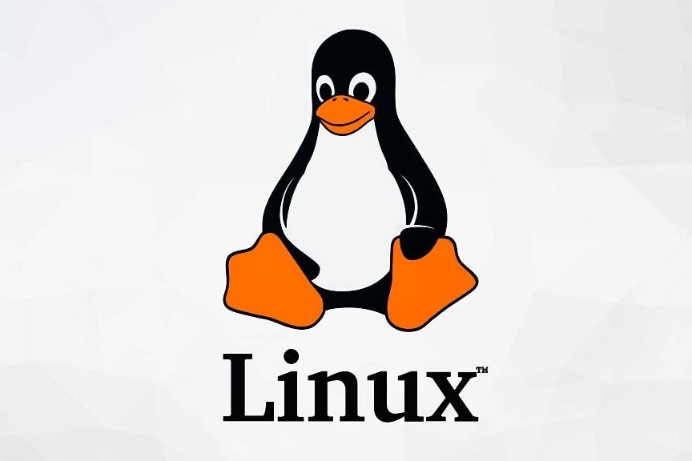

# Introducción de Implantación de Aplicaciones Web SR2A



## Documentación

La documentación técnica es **fundamental** para cualquier desarrollo de *software*, ya que permite organizar el código de forma `rápida`.

### Tabla Resumen Permisos Linux
| Comando | Función principal | Nivel de Privilegio |
| --- | --- | --- |
| `chmod` | Modifica los permisos de archivos | Usuario o Root |
| `chown` | Cambia el propietario de un archivo | Root |
| `sudo`  | Ejecuta comandos como superusuario | Root |

### Ejemplo en Linux
```bash
# Dar permisos de ejecución a un script
chmod +x script.sh
